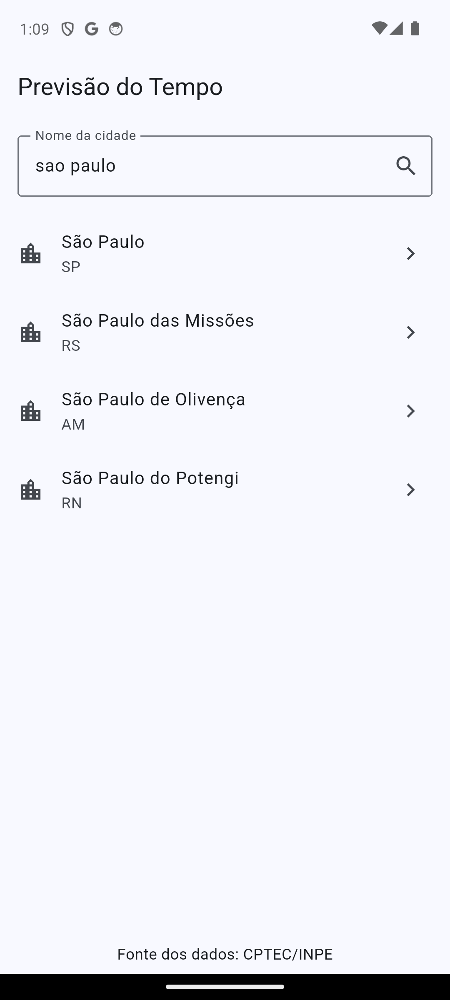
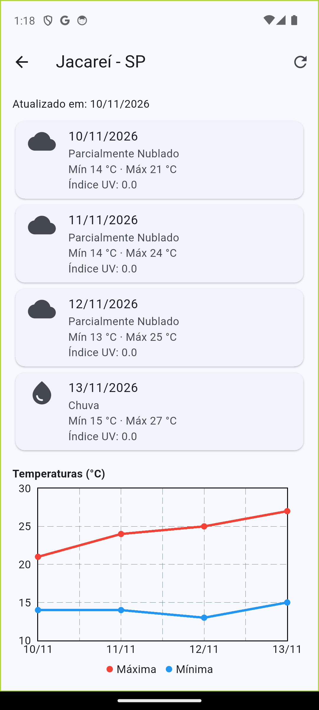
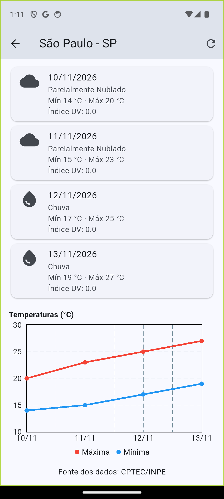
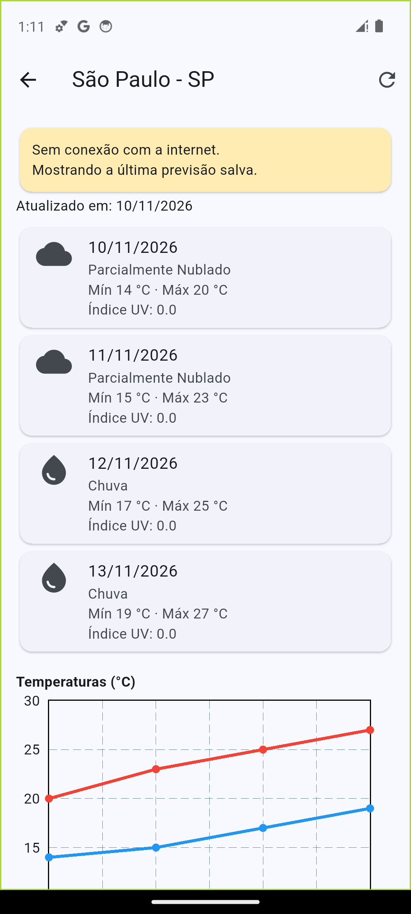

# Previsão do Tempo

Atividade 2 de Programação para Dispositivos Móveis I (Fatec, Prof. Arley).
App em Flutter que consulta a previsão do tempo de cidades brasileiras usando o serviço XML do **CPTEC/INPE**.

## Funcionalidades

- **Pesquisa de cidades**: o usuário digita o nome e o app consulta `listaCidades?city=<nome>` (os acentos são removidos, como pede a documentação). A lista mostra nome e UF; o `id` devolvido pelo serviço é usado na consulta da previsão.
- **Previsão de 4 dias** (`cidade/<id>/previsao.xml`): para cada dia mostra data, mínima e máxima em °C, descrição da condição (siglas convertidas conforme a tabela do CPTEC), ícone da condição e índice UV quando vem no XML. Mostra também a data de atualização informada pelo serviço.
- **Gráfico** de linhas com as temperaturas mínima e máxima dos 4 dias (`fl_chart`).
- **Navegação** entre a tela de busca e a tela de previsão (`Navigator.push`).
- **Atualizar**: botão na barra da tela de previsão refaz a consulta.
- **Tratamento de erros**:
  - indicador de carregamento durante as consultas;
  - "Nenhuma cidade encontrada" quando a busca volta vazia;
  - mensagens para falta de conexão, tempo esgotado, serviço indisponível (HTTP diferente de 200) e resposta inválida (XML quebrado ou com conteúdo diferente do esperado);
  - "Nenhuma previsão disponível" quando o serviço não traz dias válidos (um código inexistente volta com `null` em todos os campos);
  - campos ausentes viram `--` ou são omitidos, sem encerrar o app.
- **Fonte dos dados**: "Fonte dos dados: CPTEC/INPE" aparece nas duas telas.

## Persistência local

Feita com `shared_preferences` ([lib/armazenamento.dart](lib/armazenamento.dart)):

- **Última cidade selecionada**: salva em JSON (`id`, `nome`, `uf`). Ao abrir o app, ela aparece na tela inicial como atalho.
- **Última previsão de cada cidade**: o XML recebido é salvo com a chave `previsao_<id>`. Se uma consulta falhar (sem internet ou serviço fora), o app mostra a previsão salva com um aviso.

## Como executar

Requisitos: Flutter 3.x e um emulador ou celular Android.

```bash
flutter pub get
flutter run
```

Testes da leitura do XML (respostas válidas, campos ausentes, código inexistente e XML inválido):

```bash
flutter test
```

## Bibliotecas

| Pacote | Uso |
|---|---|
| `http` | requisições ao serviço do CPTEC |
| `xml` | leitura das respostas XML |
| `shared_preferences` | persistência local |
| `fl_chart` | gráfico de temperaturas |

## Estrutura

```
lib/
  main.dart                  # MaterialApp
  models.dart                # Cidade, PrevisaoDia, Previsao
  cptec_service.dart         # requisições, leitura do XML, siglas e ícones
  armazenamento.dart         # shared_preferences
  screens/
    busca_screen.dart        # pesquisa de cidades
    previsao_screen.dart     # previsão de 4 dias e gráfico
```

## Capturas de tela

| Busca | Previsão | Gráfico |
|---|---|---|
|  |  |  |

| Última cidade salva | Sem conexão (previsão salva) |
|---|---|
|  |  |
